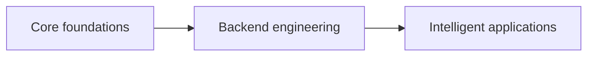

  

  

## About

I'm a third-year B.Tech student in Artificial Intelligence and Data Science at Saveetha Engineering College, Chennai (CGPA 8.1, graduating in 2028).

My main direction is **Java backend development**. I'm building that foundation through Core Java, object-oriented programming, SQL and database design, and I'm working toward Spring Boot and REST API development. **Artificial Intelligence and Data Science** is my second track, with a focus on explainable AI, computer vision and healthcare applications.

- 🔭 I'm currently working on the **Chennai Smart Mobility Planner**
- 🌱 I'm currently learning **Java, Spring Boot, REST APIs and Data Structures and Algorithms**
- 🧬 I'm researching **counterfactual explainable AI** for preventive healthcare
- 💬 Ask me about **React, TypeScript, Supabase and explainable AI**
- 📫 How to reach me: [LinkedIn](https://www.linkedin.com/in/dhayalaprabu-s-ba289932a/)
- 🎯 Preparing for **software engineering opportunities**

<!-- Optional lines to add when ready:
- 🧑‍💻 Check my latest [Portfolio](https://your-portfolio-link)
- 📝 I write articles on [Medium](https://your-medium-link)
- 📄 Know about my experience: [Resume](https://your-resume-link)
-->

## Socials

## Tech Stack

Grouped by how I use each technology today: used in projects and coursework, currently being learned, studied as academic foundations, or planned next.

### Hands-on

**Languages**

**Frontend**

**Databases and platforms**

**Tools**

### Learning now: Java backend track

### AI and Data Science foundations

### Planned next

Data Structures and Algorithms, Advanced Java, Backend Architecture and Software Testing.

## Featured Projects

### Chennai Smart Mobility Planner

<!-- To add a real app screenshot, save it as assets/mobility-screenshot.png and add:

-->

An extension of my **Chennai Metro Smart Navigator** project. It aims to provide multimodal, door-to-door journey planning across Chennai, so users can identify and compare efficient journeys across different transport options.

**Status:** ongoing project, not yet a production application.

**Feature scope**

- **Planning:** address-to-address journeys, with fastest, lowest-cost and least-walking route comparison
- **Transport modes:** metro, MTC bus, suburban railway, and walking
- **Guidance:** transfer and interchange help, metro platform and direction, station exits
- **Personalization:** saved locations and journeys, location-based navigation

<!-- Add the repository link here once it is public, for example:
**Repository:** [github.com/Dhayalaprabu/your-repo-name](https://github.com/Dhayalaprabu/your-repo-name)
-->

### Adaptive Counterfactual Explainable AI Framework

*Adaptive Counterfactual Explainable AI Framework for Personalized Lifestyle Intervention and Preventive Healthcare Using Multimodal Health Data*

**Status:** ongoing academic research project.

**Objective:** develop an AI-based framework for multiple disease-risk prediction and personalized preventive healthcare insights.

### More Projects

<b>Project showcase (expand)</b>

 

New work will be added here as it is built. Each category below is a placeholder until a project is ready to share.

- **Java backend projects:** to be added
- **Spring Boot REST API projects:** to be added
- **Database management projects:** to be added
- **Python projects:** to be added
- **AI and machine learning projects:** to be added
- **Computer vision projects:** to be added

<!-- To add a project, replace "to be added" with a line such as:
- **Project name** - one-sentence description. [Repository](https://github.com/Dhayalaprabu/repo-name)
-->

## Areas of Interest

**Software engineering**

- Backend Software Engineering
- Java Development
- Database Systems
- Intelligent Transportation Systems

**Artificial intelligence**

- Artificial Intelligence and Machine Learning
- Data Science
- Computer Vision
- Explainable AI
- Healthcare AI

## Learning Roadmap

An ongoing journey, not a list of completed qualifications.

**Current focus**

- Core Java and Object-Oriented Programming
- Python programming
- SQL and DBMS
- Git and GitHub
- Frontend fundamentals

**Next learning goals**

- Data Structures and Algorithms
- Advanced Java and Spring Boot
- REST API development
- Database design and backend architecture
- Software testing
- AI and machine learning applications

  Dhayalaprabu S. &nbsp;|&nbsp; Chennai, Tamil Nadu, India &nbsp;|&nbsp; Thanks for visiting

